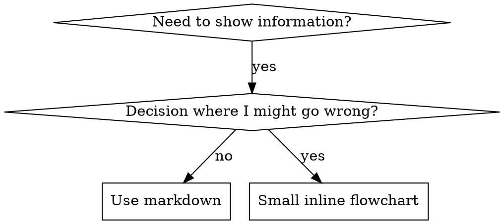

# Flowcharts in Skills

Part of `superpower-writing-skills`.

## Flowchart Usage



**Use flowcharts ONLY for:**
- Non-obvious decision points
- Process loops where you might stop too early
- "When to use A vs B" decisions

**Never use flowcharts for:**
- Reference material → Tables, lists
- Code examples → Markdown blocks
- Linear instructions → Numbered lists
- Labels without semantic meaning (step1, helper2)

See `graphviz-conventions.dot` in this directory for graphviz style rules.

**Visualizing for your human partner:** DSH does not bundle `render-graphs.js`. Render a skill's DOT flowcharts to SVG with the `dot` CLI via `bash`, one diagram per file:

```bash
dot -Tsvg path/to/diagram.dot -o path/to/diagram.svg
```

Extract each `dot` fenced code block into its own `.dot` file first — `dot` renders one graph per file. If a skill bundles a rendering script, invoke it through its interpreter (`bash scripts/render.sh`, `node scripts/render.js`), never by bare path: some plugin packagers strip executable bits, and a bare `scripts/render.sh` fails there with `Permission denied`.
